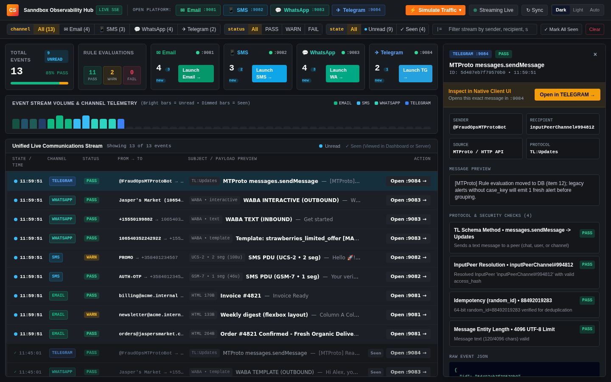
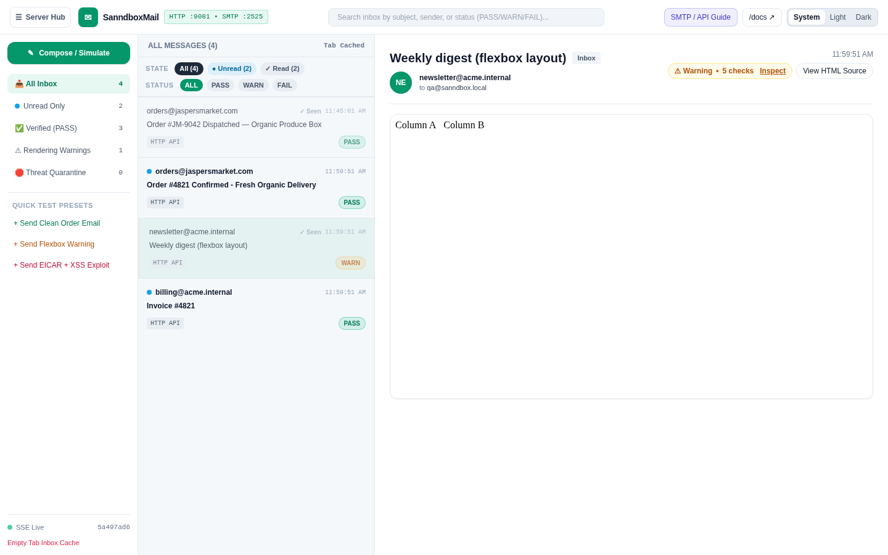
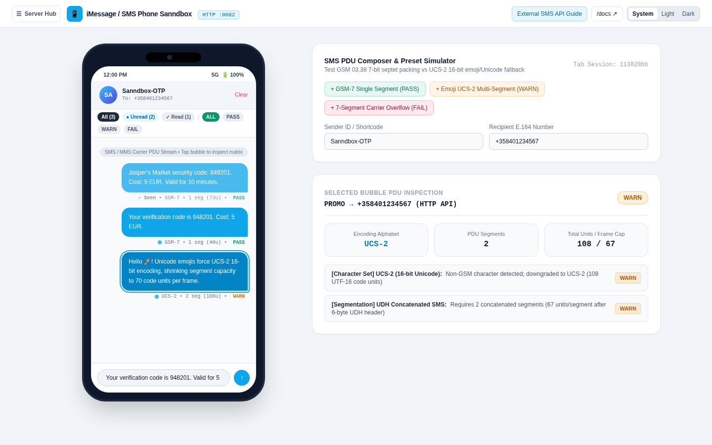
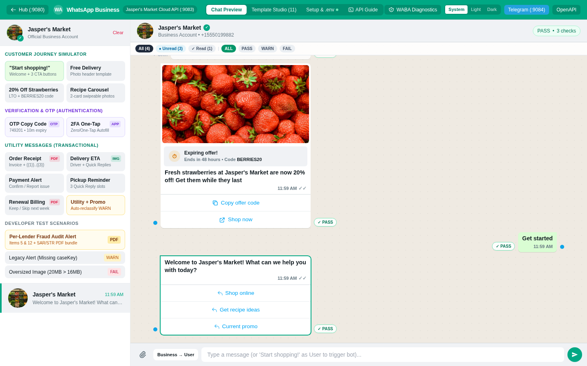
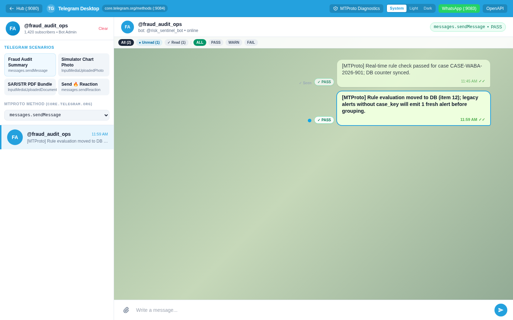
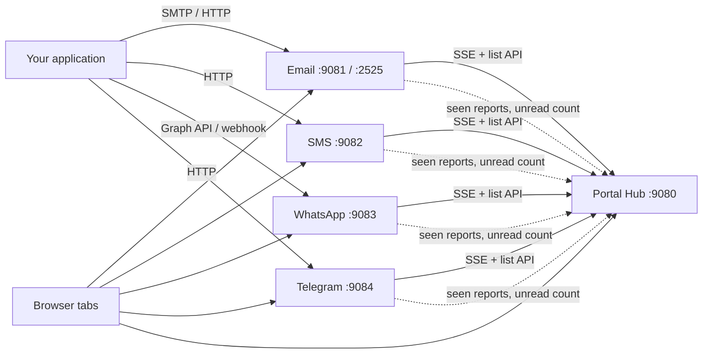

# Communications Sanndbox

A self-hosted sandbox for testing applications that send messages. It stands in for real email, SMS, WhatsApp Business and Telegram providers, so your app can send to it instead. You inspect what arrives in a realistic client UI, and every message is checked against the rules of its channel.

Nothing leaves your machine. No real email, text or chat message is ever delivered, and no provider account or API key is needed.



## What you can do with it

- **Develop without a provider account.** Point your app's SMTP host or API base URL at a local port and watch messages arrive in a familiar client UI.
- **Catch channel-specific mistakes before production.** Each message gets a PASS / WARN / FAIL evaluation with per-check details.
- **Watch every channel in one place.** The Portal aggregates all four channels into one live stream with unread tracking.
- **Demo or reproduce scenarios.** Built-in presets send typical, warning and failing messages with one click.

## What each service checks

| Service | Port | Looks like | Evaluates |
| :--- | :--- | :--- | :--- |
| **Portal Hub** | HTTP `9080` | Observability dashboard | Aggregates all channels; unread/seen tracking; traffic simulator |
| **Email** | HTTP `9081`, SMTP `2525` | 3-pane webmail inbox | HTML client rendering checks (Outlook Word engine, Gmail 102KB clipping, iOS viewport) and attachment magic-byte and threat scanning |
| **SMS** | HTTP `9082` | Smartphone Messages app | GSM-7 (160/153) vs UCS-2 (70/67) encoding and PDU segment count |
| **WhatsApp** | HTTP `9083` | WhatsApp Business chat | Meta Cloud API emulation based on the [Jasper's Market reference app](https://github.com/fbsamples/whatsapp-business-jaspers-market): Graph API messages, webhook, templates, media |
| **Telegram** | HTTP `9084` | Telegram Desktop | MTProto methods validated against the official [TL schema](https://core.telegram.org/methods) |

Each service also serves interactive OpenAPI docs at `/docs` (for example `http://localhost:9081/docs`).

| Email | SMS |
| :---: | :---: |
|  |  |
| **WhatsApp** | **Telegram** |
|  |  |

## Quick start

### Docker (all five services)

```bash
git clone https://github.com/SakariaNdadi/sanndbox.git
cd sanndbox
docker compose up --build
```

Open `http://localhost:9080`.

### Without Docker

Requires Go 1.23 or newer. Each service is its own binary; start the ones you need:

```bash
go run ./cmd/portal-server     # :9080
go run ./cmd/email-server      # :9081 (+ SMTP :2525)
go run ./cmd/sms-server        # :9082
go run ./cmd/whatsapp-server   # :9083
go run ./cmd/telegram-server   # :9084
```

The Portal finds the other services on `localhost` (or by Docker service name). Start any subset; the Portal shows which channels are connected.

## How to use it

1. **Send a message to a service** from your app, or use the presets and composer in each UI. Examples are below.
2. **See it arrive** in that channel's UI and in the Portal stream, in real time.
3. **Open the evaluation** (click a message) to see which checks passed, warned or failed and why.
4. **Fix your app and send again.** Press **Clear** in a channel UI to delete that channel's messages, or **Clear** in the Portal to wipe every channel.

### Sending messages

**Email** over HTTP:

```bash
curl -X POST http://localhost:9081/api/v1/emails -H "Content-Type: application/json" \
  -d '{"sender":"billing@acme.internal","recipients":["qa@sanndbox.local"],"subject":"Invoice #4821","htmlBody":"<!DOCTYPE html><html><head><meta name=\"viewport\" content=\"width=device-width, initial-scale=1.0\"></head><body><table><tr><td>Invoice Ready</td></tr></table></body></html>"}'
```

**Email** over SMTP (point your app's SMTP host at `localhost:2525`, no auth):

```bash
curl --url "smtp://localhost:2525" --mail-from "billing@acme.internal" --mail-rcpt "customer@example.com" -T - <<'EOF'
From: billing@acme.internal
To: customer@example.com
Subject: Invoice #9012
Content-Type: text/html; charset="UTF-8"

<!DOCTYPE html><html><head><meta name="viewport" content="width=device-width"></head><body><table><tr><td>Hello via SMTP</td></tr></table></body></html>
EOF
```

**SMS**:

```bash
curl -X POST http://localhost:9082/api/v1/sms -H "Content-Type: application/json" \
  -d '{"sender":"AUTH-OTP","recipient":"+358401234567","message":"Your verification code is 948201. Cost: 5 EUR."}'
```

**WhatsApp**, a template message through the Graph API path your app would normally call:

```bash
curl -X POST http://localhost:9083/v21.0/106540352242922/messages -H "Content-Type: application/json" \
  -d '{"messaging_product":"whatsapp","to":"+15550199882","type":"template","template":{"name":"strawberries_limited_offer","language":{"code":"en_US"}}}'
```

**WhatsApp**, simulating an inbound customer message through the webhook:

```bash
curl -X POST http://localhost:9083/webhook -H "Content-Type: application/json" \
  -d '{"object":"whatsapp_business_account","entry":[{"changes":[{"value":{"metadata":{"phone_number_id":"106540352242922"},"messages":[{"id":"wamid.inbound01","from":"+15550199882","timestamp":"1731320000","type":"text","text":{"body":"Get started"}}]}}]}]}'
```

**Telegram**:

```bash
curl -X POST http://localhost:9084/api/v1/telegram -H "Content-Type: application/json" \
  -d '{"method":"messages.sendMessage","peer":"inputPeerChannel#994812","sender":"@FraudOpsMTProtoBot","randomId":88492019283,"message":"[MTProto] Rule evaluation moved to DB (item 12); legacy alerts without case_key will emit 1 fresh alert before grouping."}'
```

### Message lifetime

Messages are shared by every browser tab and kept in server memory:

- Closing or reloading tabs never deletes anything. A new tab shows everything already received.
- **Clear** in a channel UI deletes all of that channel's messages for everyone. Open tabs and the Portal update at once.
- **Clear** in the Portal deletes the messages in all four channels.
- Stopping or restarting a server deletes its messages.

To clear from a script, call the channel's clear endpoint with `all=1`, for example `curl -X POST "http://localhost:9081/api/v1/emails/clear?all=1"` (SMS: `/api/v1/sms/clear`, WhatsApp: `/api/v1/whatsapp/clear`, Telegram: `/api/v1/telegram/clear`).

For a guided walkthrough of every UI, see [TUTORIAL.md](TUTORIAL.md).

## Unread tracking and notifications

Messages start as **unread** (blue dot, bold) and become **seen** (`✓ Seen`, muted) when you click them in any channel UI or in the Portal. Opening a message in one tab updates the others, because every UI reports to the Portal's seen API.

- The Portal and the Email, SMS, WhatsApp and Telegram UIs each have **State** (All / Unread / Read) and **Status** (PASS / WARN / FAIL) filters.
- Each tab's title shows an unread count across all channels, for example `(3) Sanndbox Mail`.
- A short chime plays when a new unread message arrives. Browsers only allow sound after you have clicked or pressed a key in that tab once.
- Tabs resync when they become visible again and every 15 seconds, so messages do not go missing in background tabs.

Deep links open a message directly: `http://localhost:9081/?id=<messageId>`.

## Portal API

| Method and path | Purpose |
| :--- | :--- |
| `GET /api/v1/feed` | Snapshot of all aggregated messages plus per-channel health. Add `?refresh=1` to re-poll the channels first. |
| `POST /api/v1/seen` | Mark messages seen. Body: `{"uid":"EMAIL:<id>"}`, `{"uids":[...]}`, `{"channel":"email","id":"<id>"}` or `{"all":true}`. |
| `POST /api/v1/feed/clear` | Delete all messages in every channel, plus the Portal feed and seen records. |
| `POST /api/v1/simulate` | Generate sample traffic. Body: `{"channel":"ALL"}`, or `EMAIL`, `SMS`, `WHATSAPP`, `TELEGRAM`. An empty channel means all. |
| `GET /events` | Server-Sent Events stream: `communication-event` for messages and seen updates, `channel-cleared` when a channel (or `ALL`) is cleared. |

## Configuration

Everything has a working default. Optional settings:

- **WhatsApp credentials and IDs.** Copy [.env.example](.env.example) to `.env` and edit. The WhatsApp server reads it on start, and Docker Compose loads it if present. `.env` is git-ignored. Never commit real tokens.
- **Portal channel addresses.** Set `EMAIL_SERVER_URL`, `SMS_SERVER_URL`, `WHATSAPP_SERVER_URL` or `TELEGRAM_SERVER_URL` if a service is not on its default host and port.

## Architecture



Each channel is an independent Go binary built with the standard library only. A channel stores messages in memory, evaluates them, and streams them to its own UI over Server-Sent Events. The Portal subscribes to every channel's stream, merges them, and keeps the seen state. Channel tabs report clicks to the Portal and subscribe to its stream for the shared unread count.

## Limitations

This is a development and testing tool, not a production service.

- **No persistence.** Messages and seen state live in memory and are lost when a service restarts. Until then they stay, whatever happens to the browser tabs.
- **No authentication.** Anyone who can reach the ports can send and read messages. The Portal also allows any origin (`Access-Control-Allow-Origin: *`). Docker Compose publishes the ports on all interfaces, so run it on a trusted network or restrict the port bindings.
- **Emulation, not delivery.** The evaluators encode documented provider rules. They do not replace testing with the real service before launch.
- **Read state is per browser.** It is stored in each browser's `localStorage`, alongside the Portal's own record.

## Project layout

```
cmd/
  portal-server/     Portal Hub (aggregator, seen API, dashboard)
  email-server/      Email sandbox
  sms-server/        SMS sandbox
  whatsapp-server/   WhatsApp Business sandbox
  telegram-server/   Telegram sandbox
    main.go          handlers, state, evaluators
    templates/       embedded single-page UI
    docs/            generated OpenAPI spec
docs/screenshots/    images used in this README
```

## Contributing

Contributions are welcome. See [CONTRIBUTING.md](CONTRIBUTING.md) for setup, checks and commit conventions.

## License

Apache License 2.0. See [LICENSE](LICENSE). The WhatsApp service adapts workflows from Meta's [whatsapp-business-jaspers-market](https://github.com/fbsamples/whatsapp-business-jaspers-market), also Apache-2.0; see [NOTICE](NOTICE).
