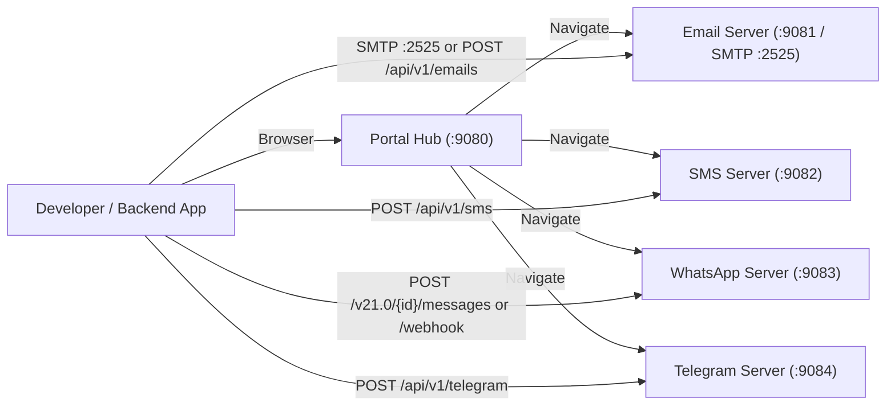

# Communications Sanndbox System - Developer Tutorial & Interactive Guide

This tutorial walks through running, clicking, inspecting, and integrating all five services in the **Communications Sanndbox System**:

1. **Portal Hub (`:9080`)** - Central channel selector and producer reference.
2. **Email Sanndbox (`:9081` HTTP / `:2525` SMTP)** - 3-pane Webmail UI with HTML client rendering checks (Outlook Word engine, Gmail 102KB clipping, iOS viewport) and attachment magic-byte/threat scanning.
3. **SMS Sanndbox (`:9082` HTTP)** - Smartphone SMS UI with GSM 03.38 (7-bit 160/153 septet) vs. UCS-2 (16-bit 70/67 code unit) PDU segmentation evaluator.
4. **WhatsApp Business Sanndbox (`:9083` HTTP)** - Meta Cloud API v21.0 & Jasper's Market emulator (`/{apiVersion}/{phoneNumberId}/messages`, `/webhook`, Template Studio, 15s read-receipt follow-up cache, and fraud audit case grouping).
5. **Telegram Desktop Sanndbox (`:9084` HTTP)** - Telegram Desktop UI with official `core.telegram.org/methods` MTProto TL-Schema validation.

---

## Architecture & Data Flow



> [!TIP]
> **Shared, In-Memory Data**: Every browser tab shows all of a channel's messages and receives new ones live over Server-Sent Events (`/events`), whether they come from the UI, `curl`, SMTP or a webhook. Closing or reloading tabs never deletes anything. Messages stay until you press **Clear** (which deletes that channel's messages for everyone; **Clear** on the Portal wipes all channels) or the server stops.

---

## Lesson 0: Configure, Build, and Start the Stack

### Step 1: Copy `.env.example` to `.env`
From the repository root:

```bash
cp .env.example .env
```

### Step 2: Launch all containers
```bash
docker compose up --build -d
```

### Step 3: Verify all 5 services are listening
```bash
docker compose ps
```

| Service | UI URL | OpenAPI / Swagger UI | Primary Ingestion Endpoint |
| :--- | :--- | :--- | :--- |
| `portal-server` | `http://localhost:9080` | `http://localhost:9080/docs` | - |
| `email-server` | `http://localhost:9081` | `http://localhost:9081/docs` | `SMTP localhost:2525` / `POST :9081/api/v1/emails` |
| `sms-server` | `http://localhost:9082` | `http://localhost:9082/docs` | `POST :9082/api/v1/sms` |
| `whatsapp-server` | `http://localhost:9083` | `http://localhost:9083/docs` | `POST :9083/v21.0/{phoneNumberId}/messages` |
| `telegram-server` | `http://localhost:9084` | `http://localhost:9084/docs` | `POST :9084/api/v1/telegram` |

---

## Lesson 1: Portal Hub (`:9080`)

**Source**: [`cmd/portal-server/main.go`](cmd/portal-server/main.go), [`cmd/portal-server/templates/index.html`](cmd/portal-server/templates/index.html)

### What It Teaches
Provides a single entry point to launch any channel emulator, synchronize theme preferences (`System` / `Light` / `Dark` via `Sanndbox_theme_mode` in `sessionStorage`), and look up producer endpoints.

### What to Click
1. Open `http://localhost:9080` in your browser.
2. **Top-Right Theme Switcher**: Click **`System`**, **`Light`**, or **`Dark`** ([`cmd/portal-server/templates/index.html`](cmd/portal-server/templates/index.html)) to toggle dark mode across the UI.
3. **Channel Cards**: Click any of the 4 cards (**`Open Email Inbox`**, **`Open Phone SMS`**, **`Open WhatsApp UI`**, **`Open Telegram UI`**) to open that emulator.
4. **Quick External Producer Reference**: At the bottom of the page ([`cmd/portal-server/templates/index.html`](cmd/portal-server/templates/index.html)), click any `:908X/docs` link to inspect the OpenAPI 3.0 specification for that service.

---

## Lesson 2: Email Webmail Inbox & Threat Scanner (`:9081` & SMTP `:2525`)

**Source**: [`cmd/email-server/main.go`](cmd/email-server/main.go), [`cmd/email-server/templates/index.html`](cmd/email-server/templates/index.html)

### What It Teaches
HTML emails render inconsistently across clients (Outlook uses Microsoft Word's rendering engine and breaks CSS Flexbox/Grid; Gmail clips HTML payloads > 102KB; mobile clients require `<meta name="viewport">`). Attachments also carry spoofing and malware risks (magic-byte mismatch, double extensions, EICAR test signatures).

### UI Walkthrough - What to Click
1. Open `http://localhost:9081`.
2. **Left Sidebar - Quick Test Presets** ([`cmd/email-server/templates/index.html`](cmd/email-server/templates/index.html)):
   - Click **`+ Send Clean Order Email`**: Dispatches a table-based HTML email with valid viewport metadata. Notice it appears in the middle pane with a green **`PASS`** badge.
   - Click **`+ Send Flexbox Warning`**: Dispatches an HTML email using `display:flex` / `display:grid`. Notice the amber **`WARN`** badge because Outlook Desktop (Word engine) ignores modern CSS layout properties.
   - Click **`+ Send EICAR + XSS Exploit`**: Dispatches an email containing `<script>` tags and an EICAR signature attachment. Notice the red **`FAIL`** badge.
3. **Left Sidebar - Folder Filters** ([`cmd/email-server/templates/index.html`](cmd/email-server/templates/index.html)):
   - Click **`All Inbox`**, **`Verified (PASS)`**, **`Rendering Warnings`**, or **`Threat Quarantine`** to filter messages by evaluation outcome.
   - Click **`Unread Only`**, or use the **State** (All / Unread / Read) and **Status** (PASS / WARN / FAIL) chips above the message list. Unread messages have a blue dot and bold text; clicking one marks it **`✓ Seen`** in every tab and in the Portal.
4. **Right Reading Pane - Inspect Diagnostics** ([`cmd/email-server/templates/index.html`](cmd/email-server/templates/index.html)):
   - Select an email in the middle column.
   - In the top-right of the reading pane, click the status pill **`✓ Verified • N checks Inspect`** (or **`⚠ Warning`** / **`✕ Quarantined`**).
   - This expands the **Client Rendering & Threat Scanner Diagnostics** drawer showing each rule check (`HTML Rendering`, `Viewport`, `Gmail Clipping`, `XSS / Script Injection`, `Attachment Magic Bytes`).
   - Click **`View HTML Source`** next to the pill to toggle between the sandboxed `<iframe>` preview and raw HTML source.
5. **Compose Custom Email & Upload Attachments**:
   - Click **`Compose / Simulate`** (top-left green button).
   - Edit `From`, `To`, `Subject`, and `HTML Body`.
   - Click **`+ Sample PDF`**, **`+ Sample Image`**, or **`+ Upload Image / PDF`** ([`cmd/email-server/templates/index.html`](cmd/email-server/templates/index.html)), then submit.
6. **Top Bar - SMTP / API Guide**:
   - Click **`SMTP / API Guide`** in the header to view copy-ready `curl` and SMTP examples.

### External Developer Integration (REST & Raw SMTP)

**Option A - HTTP REST API (`:9081`)**:
```bash
curl -X POST http://localhost:9081/api/v1/emails \
  -H "Content-Type: application/json" \
  -d '{
    "sender": "billing@acme.internal",
    "recipients": ["qa@Sanndbox.local"],
    "subject": "Invoice #4821",
    "htmlBody": "<!DOCTYPE html><html><head><meta name=\"viewport\" content=\"width=device-width, initial-scale=1.0\"></head><body><table><tr><td>Invoice #4821 Ready</td></tr></table></body></html>"
  }'
```

**Option B - Standard SMTP (`:2525`)**:
Point any app (`nodemailer`, Go `net/smtp`, Python `smtplib`, or `curl`) to `localhost:2525` (no auth required):
```bash
curl --url "smtp://localhost:2525" \
  --mail-from "alerts@acme.internal" \
  --mail-rcpt "dev@Sanndbox.local" \
  -T - <<'EOF'
From: alerts@acme.internal
To: dev@Sanndbox.local
Subject: SMTP Wire Test
Content-Type: text/html; charset=UTF-8

<!DOCTYPE html><html><head><meta name="viewport" content="width=device-width, initial-scale=1.0"></head><body><table><tr><td>Delivered over raw SMTP :2525</td></tr></table></body></html>
EOF
```

---

## Lesson 3: Phone SMS Messenger & PDU Segment Evaluator (`:9082`)

**Source**: [`cmd/sms-server/main.go`](cmd/sms-server/main.go), [`cmd/sms-server/templates/index.html`](cmd/sms-server/templates/index.html)

### What It Teaches
SMS carriers bill and fragment messages by **PDU encoding**:
- **GSM-7 (7-bit default alphabet)**: Fits **160 septets** in a single SMS. Extended characters (`€`, `{`, `}`, `[`, `]`, `~`, `^`, `\`, `|`) consume **2 septets** (escape `0x1B` + character). If a message exceeds 160 septets, a 6-byte User Data Header (UDH) reduces each concatenated segment to **153 septets**.
- **UCS-2 (16-bit Unicode)**: Adding a single emoji or non-GSM character forces the entire message into 16-bit UCS-2, cutting capacity to **70 code units** (single) or **67 code units** per multi-part segment.
- **Carrier Overflow**: Messages exceeding 6 concatenated segments risk silent carrier drops (`FAIL`).

### UI Walkthrough - What to Click
1. Open `http://localhost:9082`.
2. **Right Panel - SMS PDU Composer & Preset Simulator** ([`cmd/sms-server/templates/index.html`](cmd/sms-server/templates/index.html)):
   - Click **`+ GSM-7 Single Segment (PASS)`**: Sends a standard OTP message. Look at the phone screen on the left: the metadata under the blue bubble reads `GSM-7 • 1 seg (54u) • PASS`.
   - Click **`+ Emoji UCS-2 Multi-Segment (WARN)`**: Sends a message with emojis. Notice the encoding switches to `UCS-2`, the per-segment limit drops from `160` to `67`, and the status flags **`WARN`** due to multi-part concatenation cost.
   - Click **`+ 7-Segment Carrier Overflow (FAIL)`**: Sends a long payload that exceeds the 6-segment carrier threshold, triggering **`FAIL`**.
3. **Left Panel - Interactive Smartphone Screen** ([`cmd/sms-server/templates/index.html`](cmd/sms-server/templates/index.html)):
   - **Click any blue SMS bubble** inside the phone frame to load its breakdown in the **Selected Bubble PDU Inspection** card on the right ([`cmd/sms-server/templates/index.html`](cmd/sms-server/templates/index.html)).
   - Inspect the 3 metric tiles: **Encoding Alphabet**, **PDU Segments**, and **Total Units / Frame Cap**.
   - Type a message in the bottom input bar of the phone (`iMessage / SMS text...`) - try typing `Cost: 5 €` vs `Cost: 5 🚀` and click the blue **`↑`** send button to see the difference between a 2-septet GSM-7 extension character (`€`) and a UCS-2 downgrade (`🚀`).
4. **Top Bar - External SMS API Guide**:
   - Click **`External SMS API Guide`** ([`cmd/sms-server/templates/index.html`](cmd/sms-server/templates/index.html)) and click **`Copy cURL Command`**.

### External Developer Integration
```bash
curl -X POST http://localhost:9082/api/v1/sms \
  -H "Content-Type: application/json" \
  -d '{
    "sender": "AUTH-OTP",
    "recipient": "+358401234567",
    "message": "Your verification code is 948201. Cost: 5 EUR."
  }'
```

---

## Lesson 4: WhatsApp Business Cloud API & Jasper's Market (`:9083`)

**Source**: [`cmd/whatsapp-server/main.go`](cmd/whatsapp-server/main.go), [`cmd/whatsapp-server/templates/index.html`](cmd/whatsapp-server/templates/index.html)

### What It Teaches
Emulates Meta's official WhatsApp Business Platform (`v21.0`) and the `fbsamples/whatsapp-business-jaspers-market` reference architecture, including:
- Customer-initiated webhook journeys (`POST /webhook` with `X-Hub-Signature-256` verification)
- Outbound Cloud API messages (`POST /{apiVersion}/{phoneNumberId}/messages`)
- `AUTHENTICATION` (OTP Copy Code & One-Tap Autofill), `UTILITY` (receipts, ETA, billing), and `MARKETING` (LTO promotions, swipeable carousels) templates
- Meta Policy Violation checks (e.g., promotional upsell inside a `UTILITY` template)
- 15-second Redis read-receipt follow-up simulation (`Conversation.handleStatus`)
- Fraud Audit Case Grouping (`caseKey` validation and SAR/STR PDF bundles)

### UI Walkthrough - What to Click (4 Top Navigation Tabs)

Open `http://localhost:9083`. Notice the 4 view tabs in the top green header ([`cmd/whatsapp-server/templates/index.html`](cmd/whatsapp-server/templates/index.html)): **`Chat Preview`**, **`Template Studio`**, **`Setup & .env`**, and **`API Guide`**.

#### Tab 1: `Chat Preview`
1. **Customer Journey Simulator (Left Sidebar)** ([`cmd/whatsapp-server/templates/index.html`](cmd/whatsapp-server/templates/index.html)):
   - Click **`"Start shopping!"`**: Simulates an inbound customer message (`User → Business`) followed by Jasper's Market's automated interactive reply containing 3 CTA buttons (`Shop online`, `Get recipe ideas`, `Current promo`).
   - **Inside the Chat Window**: Click the interactive reply buttons directly on the WhatsApp bubble (**`Shop online`**, **`Get recipe ideas`**, **`Current promo`**) or click **`Free Delivery`**, **`20% Off Strawberries`**, and **`Recipe Carousel`** in the left sidebar to see full-bleed photo headers, promo copy-code buttons (`BERRIES20`), and 2-card horizontal swipeable carousels.
2. **Verification & OTP (`AUTHENTICATION`)** ([`cmd/whatsapp-server/templates/index.html`](cmd/whatsapp-server/templates/index.html)):
   - Click **`OTP Copy Code`**: Sends `auth_otp_verification` with a `Copy code` button and 10-minute expiration footer.
   - Click **`2FA One-Tap`**: Sends `auth_2fa_onetap_autofill` validating Android `package_name` and 11-character `signature_hash`.
3. **Utility Messages (`UTILITY`) & Policy Violation Check** ([`cmd/whatsapp-server/templates/index.html`](cmd/whatsapp-server/templates/index.html)):
   - Click **`Order Receipt`**, **`Delivery ETA`**, **`Payment Alert`**, **`Pickup Reminder`**, or **`Renewal Billing`** to test transactional templates with PDF/Image headers and quick-reply buttons.
   - Click **`Utility + Promo`** (amber button): Sends a `UTILITY` template polluted with promotional discount copy. Click the resulting bubble to see why Meta WABA flags it as **`WARN`** (risk of automatic reclassification to `MARKETING` billing).
4. **Developer Test Scenarios (Fraud Audit & Media Limits)** ([`cmd/whatsapp-server/templates/index.html`](cmd/whatsapp-server/templates/index.html)):
   - Click **`Per-Lender Fraud Audit Alert`**: Dispatches a grouped fraud alert with a `caseKey` and attached SAR/STR PDF bundle (`PASS`).
   - Click **`Legacy Alert (Missing caseKey)`**: Triggers a **`WARN`** showing that legacy alerts without `caseKey` emit 1 fresh alert before DB grouping.
   - Click **`Oversized Image (20MB > 16MB)`**: Triggers a **`FAIL`** demonstrating Meta's 16MB image size ceiling.
5. **15s Read-Receipt Follow-Up & Right Diagnostics Drawer** ([`cmd/whatsapp-server/templates/index.html`](cmd/whatsapp-server/templates/index.html)):
   - Click **`WABA Diagnostics`** in the top-right header (or click any message bubble in the chat).
   - When an interactive bot response is selected, look for the blue **`15s Redis Follow-Up Armed`** banner in the right drawer ([`cmd/whatsapp-server/templates/index.html`](cmd/whatsapp-server/templates/index.html)) and click **`Simulate Read ✓✓`** (or wait 15 seconds) to watch Jasper's Market automatically send the `"Is there anything else we can help you with?"` follow-up prompt.
6. **Bottom Composer Bar** ([`cmd/whatsapp-server/templates/index.html`](cmd/whatsapp-server/templates/index.html)):
   - Click the direction toggle button **`Business → User`** / **`User → Business`** to switch between sending outbound business messages and simulating inbound customer replies.
   - Click the paperclip icon to attach an image or PDF.

#### Tab 2: `Template Studio`
1. Click **`Template Studio`** in the top bar ([`cmd/whatsapp-server/templates/index.html`](cmd/whatsapp-server/templates/index.html)).
2. Browse preloaded templates on the left and click **`Send to Chat →`** on any card.
3. Use the **Create Authentication / Utility / Marketing Template** form on the right to build a custom template with `{{1}}`, `{{2}}` variables, watch the **Live Customer View** preview update as you type, and click **`Save & Send Template to Chat`**.

#### Tab 3: `Setup & .env`
1. Click **`Setup & .env`** in the top bar ([`cmd/whatsapp-server/templates/index.html`](cmd/whatsapp-server/templates/index.html)).
2. Edit `PHONE_NUMBER_ID`, `WABA_ID`, `GROCERIES_MEDIA_ID`, or `STRAWBERRIES_MEDIA_ID` and click **`Validate & Save .env`**.
3. Click **`Test '12345' Placeholder Error`** to see how the configurator catches unconfigured placeholder media IDs (`MediaIDPlaceholder`), or click **`Copy .env`** to copy the generated environment file.

#### Tab 4: `API Guide`
1. Click **`API Guide`** in the top bar ([`cmd/whatsapp-server/templates/index.html`](cmd/whatsapp-server/templates/index.html)) for copy-ready `curl` commands for every Cloud API endpoint.

### External Developer Integration
```bash
# 1. Send an Outbound Graph API Template
curl -X POST http://localhost:9083/v21.0/106540352242922/messages \
  -H "Content-Type: application/json" \
  -d '{
    "messaging_product": "whatsapp",
    "to": "+15550199882",
    "type": "template",
    "template": {
      "name": "strawberries_limited_offer",
      "language": { "code": "en_US" }
    }
  }'

# 2. Simulate an Inbound Customer Webhook Event
curl -X POST http://localhost:9083/webhook \
  -H "Content-Type: application/json" \
  -d '{
    "object": "whatsapp_business_account",
    "entry": [{
      "changes": [{
        "value": {
          "metadata": { "phone_number_id": "106540352242922" },
          "messages": [{
            "id": "wamid.inbound01",
            "from": "+15550199882",
            "timestamp": "1731320000",
            "type": "text",
            "text": { "body": "Get started" }
          }]
        }
      }]
    }]
  }'
```

---

## Lesson 5: Telegram Desktop & MTProto TL-Schema Evaluator (`:9084`)

**Source**: [`cmd/telegram-server/main.go`](cmd/telegram-server/main.go), [`cmd/telegram-server/templates/index.html`](cmd/telegram-server/templates/index.html)

### What It Teaches
Validates Telegram RPC requests against official `core.telegram.org/methods` MTProto TL-Schema specifications:
- **Peer Constructor Resolution**: Validates `InputPeer` format (`@username`, `inputPeerChannel#id`, `inputPeerChat#id`, `inputPeerUser#id`).
- **64-bit `random_id` Idempotency**: Write methods (`messages.sendMessage`, `messages.sendMedia`, `messages.sendMultiMedia`, `messages.forwardMessages`) require a non-zero 64-bit `random_id` to prevent duplicate message delivery on retry.
- **Length Ceilings**: Enforces 4,096 UTF-8 characters for `messages.sendMessage` text and 1,024 UTF-8 characters for media captions (`messages.sendMedia`).
- **TL Media Constructors**: Distinguishes `InputMediaUploadedPhoto` (compressed photo rendering, <= 10MB) from `InputMediaUploadedDocument` (file card rendering, <= 2GB).

### UI Walkthrough - What to Click
1. Open `http://localhost:9084`.
2. **Left Sidebar - Telegram Scenarios** ([`cmd/telegram-server/templates/index.html`](cmd/telegram-server/templates/index.html)):
   - Click **`Fraud Audit Summary`**: Invokes `messages.sendMessage` to `@fraud_audit_ops` with a valid 64-bit `randomId`.
   - Click **`Simulator Chart Photo`**: Invokes `messages.sendMedia` with `tlType: InputMediaUploadedPhoto`, rendering an inline photo bubble.
   - Click **`SAR/STR PDF Bundle`**: Invokes `messages.sendMedia` with `tlType: InputMediaUploadedDocument`, rendering a Telegram document card with circular file icon and byte size.
   - Click **`Send 🔥 Reaction`**: Invokes `messages.sendReaction`, attaching a `🔥 1` reaction pill to the message bubble.
3. **Left Sidebar - MTProto Method Selector** ([`cmd/telegram-server/templates/index.html`](cmd/telegram-server/templates/index.html)):
   - Use the dropdown to switch between all 10 supported MTProto methods (`messages.sendMessage`, `messages.sendMedia`, `messages.sendMultiMedia`, `messages.forwardMessages`, `messages.editMessage`, `messages.deleteMessages`, `messages.sendReaction`, `messages.getHistory`, `channels.ExportMessageLink`, `users.getFullUser`).
4. **Center Chat & Right MTProto Diagnostics Drawer** ([`cmd/telegram-server/templates/index.html`](cmd/telegram-server/templates/index.html)):
   - Click any green/blue Telegram bubble (or the **`✓ PASS`** pill beside it) to open the **MTProto Method Inspector** on the right.
   - Inspect the expected **Return TL** type (`Updates`, `messages.Messages`, `ExportedMessageLink`, `users.UserFull`), the `random_id`, and each TL-Schema validation check.
   - In the inspector drawer, you can also edit advanced parameters (`peer`, `randomId` - try setting `randomId` to `0` on `messages.sendMessage` to see the idempotency warning/failure) and click the paperclip icon in the bottom bar to attach custom images or PDFs.

### External Developer Integration
```bash
curl -X POST http://localhost:9084/api/v1/telegram \
  -H "Content-Type: application/json" \
  -d '{
    "method": "messages.sendMessage",
    "peer": "inputPeerChannel#994812",
    "sender": "@FraudOpsMTProtoBot",
    "randomId": 88492019283,
    "message": "[MTProto] Rule evaluation moved to DB (item 12); legacy alerts without case_key will emit 1 fresh alert before grouping."
  }'
```
